<p align="center">
  
  &nbsp;&nbsp;&nbsp;
  
</p>

<h1 align="center">InovaHub</h1>

<p align="center">
  CRM para o relacionamento entre o <strong>InovaParq</strong> (Parque de Inovação da UNIVILLE) e as empresas do seu ecossistema.
</p>

<p align="center">
  
  
  
  
  
  
</p>

---

## Sumário

1. [Sobre o projeto](#sobre-o-projeto)
2. [Telas implementadas](#telas-implementadas)
3. [Tecnologias](#tecnologias)
4. [Como rodar](#como-rodar)
5. [Banco de dados e API](#banco-de-dados-e-api)
6. [Modelagem UML](#modelagem-uml)
7. [Cadastro de empresas](#cadastro-de-empresas)
8. [Usuários de demonstração](#usuários-de-demonstração)
9. [Estrutura de pastas](#estrutura-de-pastas)
10. [Documentação](#documentação)
11. [Roadmap](#roadmap)
12. [Como contribuir](#como-contribuir)
13. [Créditos](#créditos)

---

## Sobre o projeto

O **InovaHub** é um sistema de **CRM** (*Customer Relationship Management*) feito sob medida para o **InovaParq**, o parque de inovação da **UNIVILLE**, em Joinville/SC. Ele reúne em um só lugar as empresas residentes, incubadas, parceiras e prospects, os contatos e as interações da equipe do parque, com indicadores para apoiar decisões.

Esta é a etapa **CDI-2**: a implementação a partir dos protótipos de tela (feitos no CDI-1). O sistema tem três partes:

- **Front-end** em React, com todas as telas do protótipo.
- **API** em Node.js com Express, na pasta [`server/`](server).
- **Banco MySQL**, com o esquema e a carga inicial em [`database/`](database).

As telas funcionam de dois jeitos: ligadas à API e ao MySQL, ou em **modo demonstração**, com os dados guardados no próprio navegador, para apresentar o protótipo sem instalar nada. O escopo completo está em [`docs/ESCOPO.md`](docs/ESCOPO.md).

## Telas implementadas

| Tela | Rota | Situação |
|---|---|---|
| Login (e login com erro) | `/login` | ✅ |
| Dashboard (indicadores e gráficos) | `/` | ✅ |
| Listagem de empresas (filtros, ordenação, EmptyView) | `/empresas` | ✅ |
| Adicionar empresa (e com erros) | `/empresas/nova` | ✅ |
| Editar empresa (e com erros) | `/empresas/:id/editar` | ✅ |
| Desativar e reativar empresa | ações da listagem e da ficha | ✅ |
| Ficha da empresa | `/empresas/:id` | ✅ |
| Usuários, novo e editar usuário | `/usuarios`, `/usuarios/novo`, `/usuarios/:id/editar` | ✅ |
| Permissões por perfil | `/permissoes` | ✅ |
| Relatórios | `/relatorios` | ✅ |
| Configurações | `/configuracoes` | ✅ |
| Meu perfil | `/perfil` | ✅ |
| Erro 404 | qualquer rota inexistente | ✅ |
| Acesso não autorizado (403) | `/acesso-negado` | ✅ |

Legenda: ✅ pronta · 🟡 em andamento · ⚪ a fazer

### Capturas

| | |
|---|---|
|  Login |  Login com erro |
| 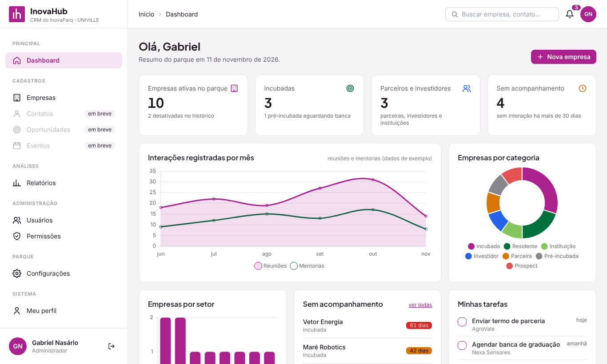 Dashboard | 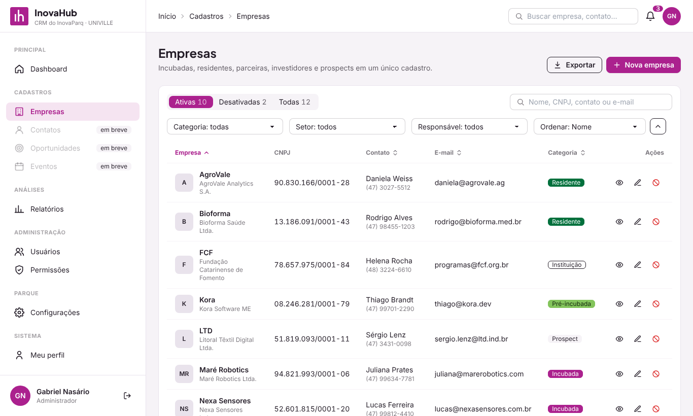 Listagem de empresas |
| 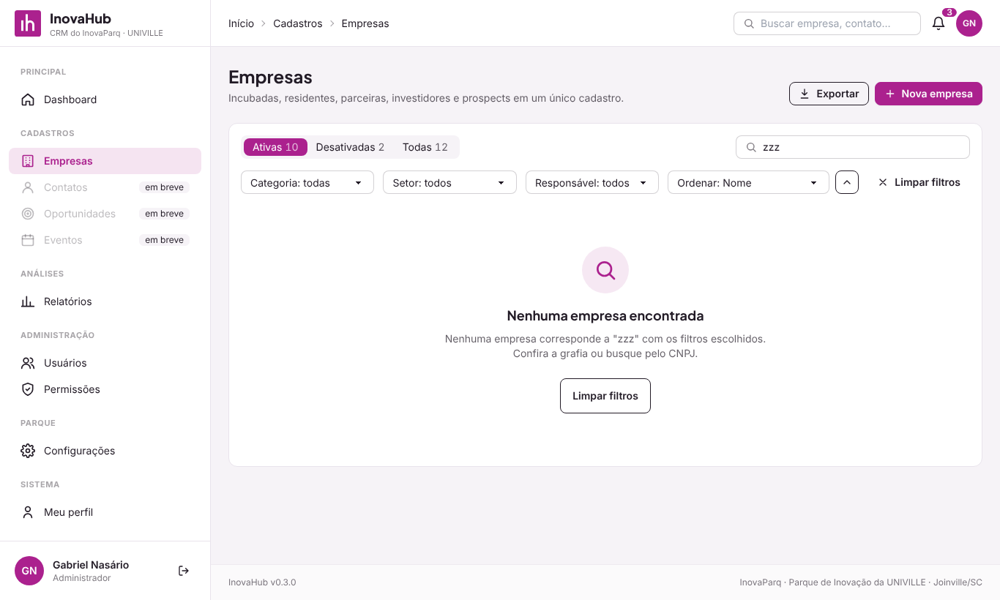 Busca sem resultado | 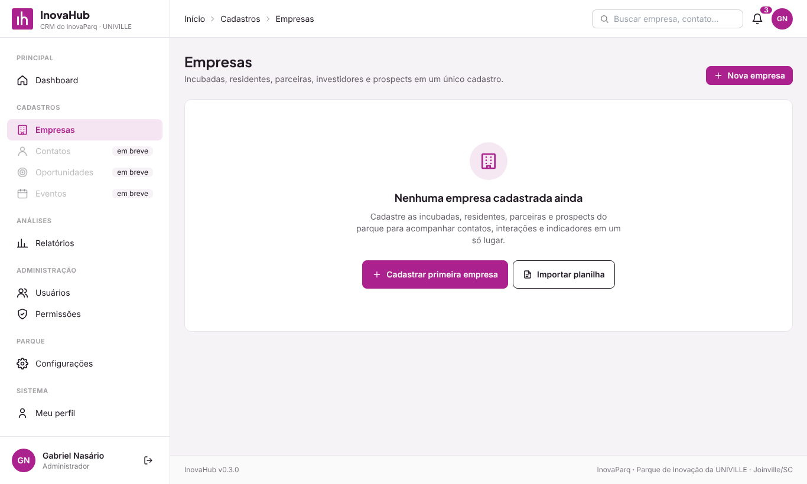 Nenhuma empresa cadastrada (EmptyView) |
|  Adicionar empresa | 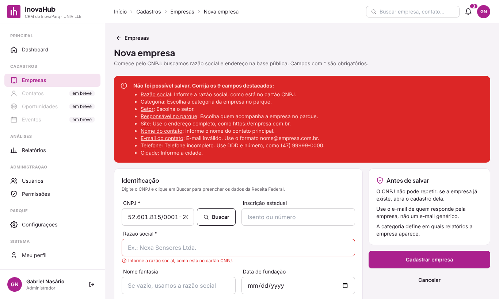 Adicionar empresa com erros |
| 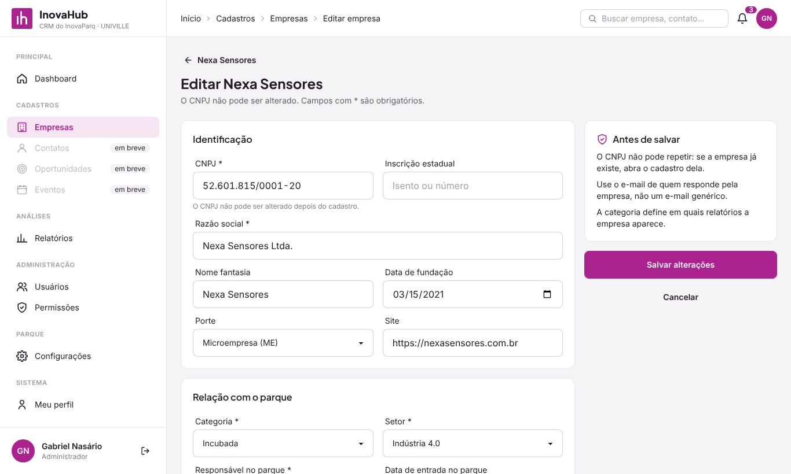 Editar empresa | 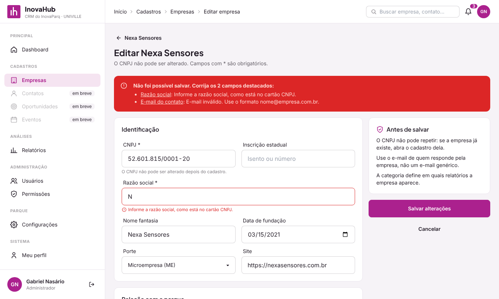 Editar empresa com erros |
| 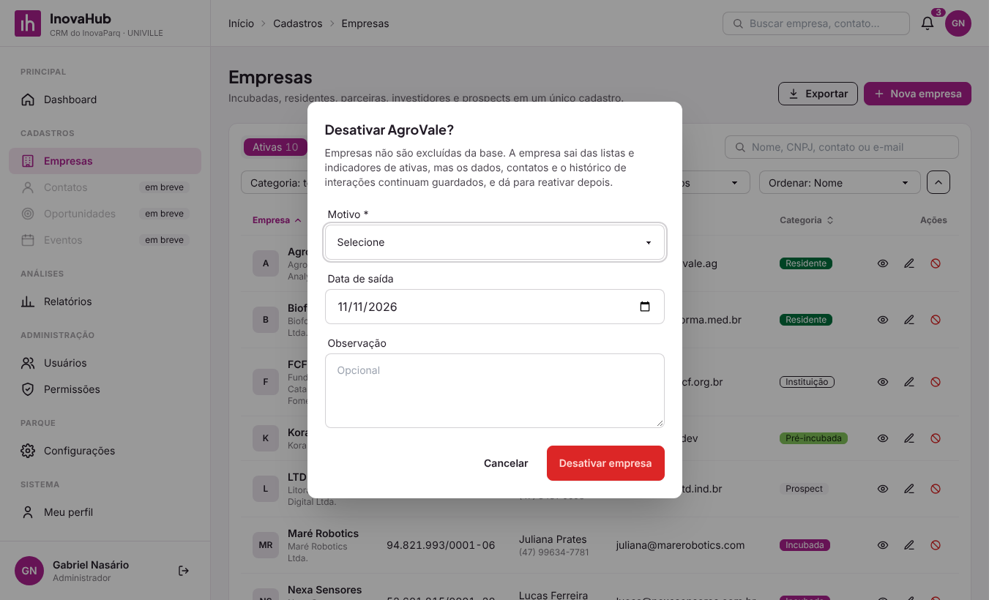 Desativar empresa | 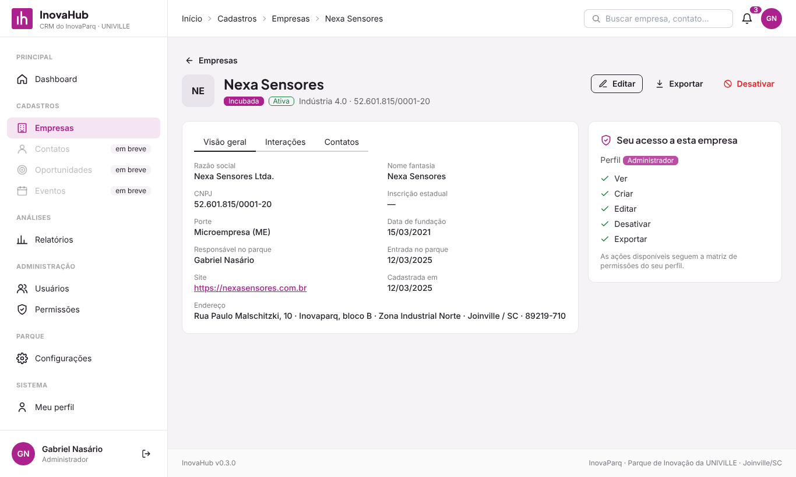 Ficha da empresa |
| 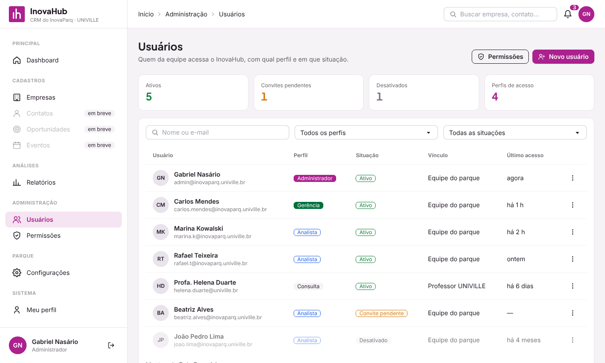 Usuários | 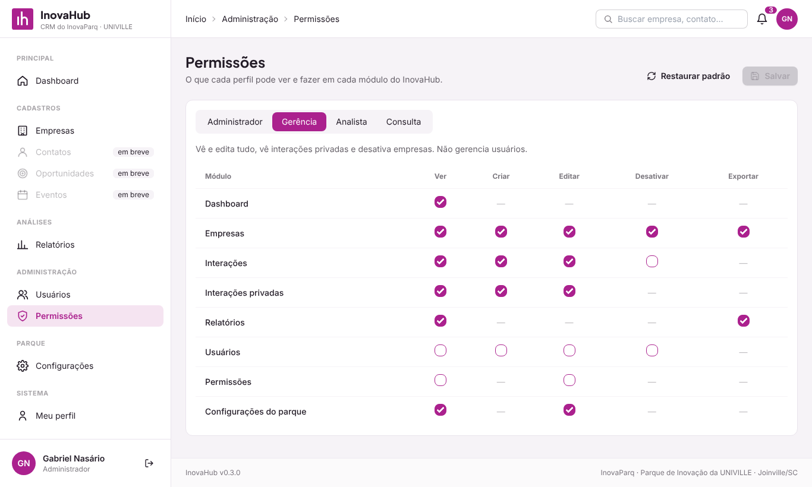 Permissões |
| 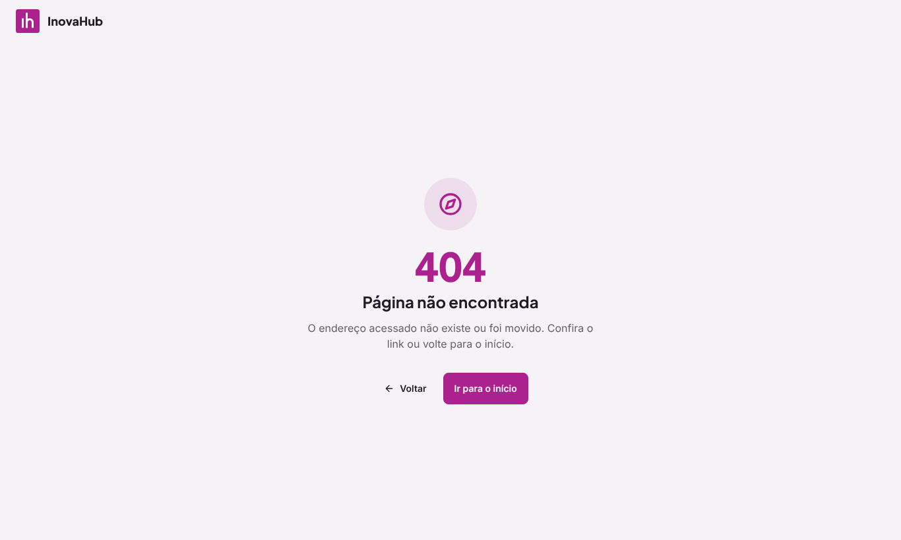 Erro 404 | 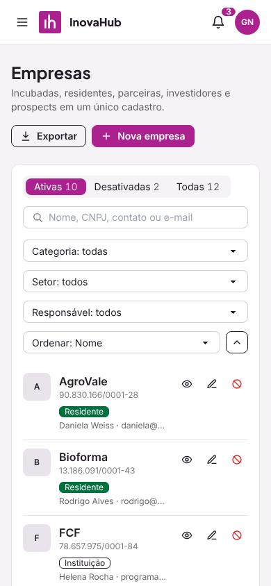 Empresas no celular |

## Tecnologias

| Item | Escolha |
|---|---|
| Interface | [React 18](https://react.dev/) |
| Build e servidor local | [Vite](https://vitejs.dev/) |
| Rotas | [React Router 6](https://reactrouter.com/) |
| Estilo e componentes | [Tailwind CSS](https://tailwindcss.com/) + [DaisyUI](https://daisyui.com/) |
| Gráficos | [Chart.js](https://www.chartjs.org/) |
| API | [Node.js 20](https://nodejs.org/) + [Express 4](https://expressjs.com/) |
| Banco de dados | [MySQL 8](https://dev.mysql.com/doc/) (ou MariaDB 10.6+) com [mysql2](https://sidorares.github.io/node-mysql2/docs) |
| Autenticação | Senhas com bcrypt e sessão com token JWT |
| Testes | [Vitest](https://vitest.dev/) e [Supertest](https://github.com/ladjs/supertest) |

## Como rodar

Pré-requisitos: [Node.js](https://nodejs.org/) 20 ou mais recente e, para usar o banco, [MySQL](https://dev.mysql.com/downloads/) 8.

### Com o banco MySQL

```bash
git clone https://github.com/SrSuco/inovahub.git
cd inovahub

# 1. API e banco
cd server
cp .env.example .env      # informe usuário e senha do seu MySQL
npm install
npm run db:criar          # cria o banco "inovahub", as tabelas e os dados de exemplo
npm run dev               # API em http://localhost:3333/api

# 2. Telas (em outro terminal, na raiz do projeto)
cd ..
cp .env.example .env      # já vem com VITE_API_URL=/api
npm install
npm run dev               # http://localhost:5173
```

### Só as telas (modo demonstração)

```bash
npm install
npm run dev
```

Sem o arquivo `.env` (ou com `VITE_API_URL` vazio), as telas usam dados de exemplo guardados no navegador.

| Comando | O que faz |
|---|---|
| `npm run dev` | Sobe o servidor de desenvolvimento |
| `npm test` | Roda os testes automatizados |
| `npm run build` | Gera a versão de produção em `dist/` |
| `npm run preview` | Serve a versão de produção localmente |
| `cd server && npm test` | Roda os testes da API contra o MySQL (banco `inovahub_teste`) |

## Banco de dados e API

- **Esquema:** 18 tabelas em [`database/schema.sql`](database/schema.sql), com chaves estrangeiras, índices e restrições. A carga inicial em [`database/seed.sql`](database/seed.sql) traz os mesmos dados do protótipo.
- **Documentação do banco:** diagrama entidade-relacionamento e decisões de modelagem em [`docs/banco-de-dados.md`](docs/banco-de-dados.md).
- **API:** rotas, variáveis de ambiente e segurança em [`server/README.md`](server/README.md).

Empresas e usuários **nunca são excluídos**: a API não tem rota `DELETE`, e a desativação grava o motivo e a data em uma tabela de histórico.

## Modelagem UML

Os diagramas ficam em [`docs/uml/`](docs/uml), em Mermaid (o GitHub desenha direto na página) e em SVG:

| Diagrama | O que mostra |
|---|---|
| [Casos de uso](docs/uml/casos-de-uso.md) | O que cada perfil pode fazer |
| [Classes](docs/uml/classes.md) | Entidades do domínio e camadas da aplicação |
| [Sequência](docs/uml/sequencia.md) | Login, cadastro e desativação de empresa, do navegador ao banco |
| [Estados](docs/uml/estados.md) | Ciclo de vida da empresa, do usuário e das oportunidades |
| [Componentes](docs/uml/componentes.md) | Front-end, API e MySQL |

## Cadastro de empresas

Implementa o pedido da etapa CDI-2 para o cadastro de empresas:

- **Listagem** com abas Ativas, Desativadas e Todas, busca por nome, CNPJ, contato ou e-mail, filtros por categoria, setor e responsável, e ordenação por nome, contato, e-mail, categoria, última interação ou data de cadastro.
- **EmptyView** quando não há empresas cadastradas e quando a busca não encontra nada.
- **Adicionar e editar** com validação campo a campo e resumo de erros no topo. O CNPJ não pode repetir nem ser alterado depois do cadastro.
- **Desativar** no lugar de excluir: a empresa sai das ativas, mas mantém os dados e o histórico, e pode ser reativada.

As regras completas estão na [seção 6 do escopo](docs/ESCOPO.md#6-módulo-cadastro-de-empresas).

> Dica (modo demonstração): para ver a tela vazia, rode `localStorage.setItem('inovahub:empresas', '[]')` no console do navegador e recarregue. Para voltar aos dados de exemplo, rode `localStorage.removeItem('inovahub:empresas')`.

## Usuários de demonstração

Todos usam a senha **`inovahub`**.

| Usuário | Perfil | O que pode fazer |
|---|---|---|
| `admin` | Administrador | Tudo, inclusive usuários, permissões e desativação de empresas |
| `gerencia` | Gerência | Vê e edita tudo e desativa empresas; não gerencia usuários |
| `analista` | Analista | Cria e edita empresas e interações |
| `consulta` | Consulta | Somente leitura |

Os mesmos usuários existem no modo demonstração e na carga inicial do banco. Marque **Manter conectado** no login para continuar logado ao recarregar a página. No modo demonstração, os dados ficam no navegador (`localStorage`); para voltar ao estado inicial, limpe os dados do site. Com o banco, rode `npm run db:criar` na pasta `server`.

## Estrutura de pastas

```text
inovahub/
├── database/
│   ├── schema.sql         # Tabelas, chaves e índices do MySQL
│   └── seed.sql           # Carga inicial (dados do protótipo)
├── docs/
│   ├── ESCOPO.md          # Escopo do projeto para codificação
│   ├── banco-de-dados.md  # Diagrama ER e decisões de modelagem
│   ├── uml/               # Diagramas UML (Mermaid e SVG)
│   └── telas/             # Capturas das telas implementadas
├── public/                # Arquivos servidos como estão (favicon)
├── server/                # API Node.js + Express (veja server/README.md)
│   ├── scripts/           # Criação do banco
│   ├── src/               # Rotas, middlewares e repositórios SQL
│   └── test/              # Testes de integração com o MySQL
├── src/
│   ├── assets/            # Logos institucionais
│   ├── components/        # Componentes reutilizáveis e layout
│   ├── contexts/          # Sessão, tema e avisos
│   ├── data/              # Dados de exemplo e permissões
│   ├── hooks/             # Hooks reutilizáveis
│   ├── pages/             # Telas, agrupadas por módulo
│   │   ├── autenticacao/  # Login
│   │   ├── configuracoes/
│   │   ├── dashboard/
│   │   ├── empresas/      # Listagem, formulário, ficha, desativação e regras
│   │   ├── erros/         # 404 e 403
│   │   ├── perfil/
│   │   ├── permissoes/
│   │   ├── relatorios/
│   │   └── usuarios/
│   ├── services/          # Acesso a dados: API ou modo demonstração
│   ├── utils/             # Funções auxiliares
│   ├── App.jsx            # Rotas
│   └── main.jsx           # Ponto de entrada
├── CHANGELOG.md           # Histórico de versões
├── CONTRIBUTING.md        # Fluxo de branches, commits e versões
└── README.md
```

## Documentação

- [Escopo do projeto (CDI-2)](docs/ESCOPO.md)
- [Diagramas UML](docs/uml/README.md)
- [Banco de dados](docs/banco-de-dados.md)
- [API](server/README.md)
- [Guia de contribuição](CONTRIBUTING.md)
- [Histórico de versões](CHANGELOG.md)

## Roadmap

| Versão | Conteúdo | Situação |
|---|---|---|
| `v0.1.0` | Estrutura, design system, layout, login, erros 404/403 | ✅ |
| `v0.2.0` | Cadastro de empresas | ✅ |
| `v0.3.0` | Dashboard | ✅ |
| `v0.4.0` | Usuários, permissões, relatórios, configurações e perfil | ✅ |
| `v0.5.0` | Diagramas UML, banco MySQL e API ligada às telas | ✅ |
| `v0.6.0` | Interações, contatos e oportunidades usando as tabelas novas | ⚪ |
| `v1.0.0` | Implantação no servidor do parque | ⚪ |

## Como contribuir

Leia o [guia de contribuição](CONTRIBUTING.md). Em resumo: crie uma branch a partir da `develop`, faça commits pequenos no padrão `tipo: descrição`, rode `npm test`, `npm run build` e `cd server && npm test`, e abra um pull request.

## Créditos

Projeto desenvolvido no contexto de estágio junto ao **InovaParq, Parque de Inovação da UNIVILLE**, Joinville/SC.

- **Desenvolvimento:** Gabriel Nasário
- **Instituições:** InovaParq · UNIVILLE
