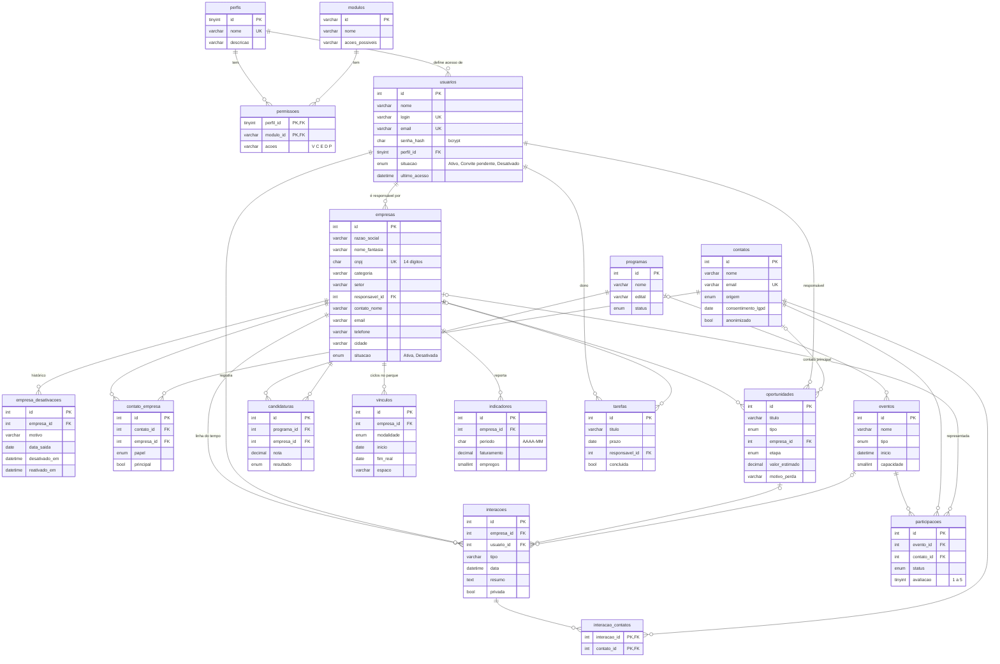

# Banco de dados

O InovaHub usa **MySQL 8** (também roda em MariaDB 10.6 ou mais novo). Os scripts ficam em [`database/`](../database):

| Arquivo | Conteúdo |
| --- | --- |
| [`schema.sql`](../database/schema.sql) | Criação das 18 tabelas, chaves, índices, restrições e da visão `vw_empresas` |
| [`seed.sql`](../database/seed.sql) | Carga inicial com os mesmos dados do protótipo: 4 perfis, 8 módulos, 7 usuários e 12 empresas |

## Como criar o banco

Com o MySQL rodando, o jeito mais simples é usar o script da API, que lê o `.env`:

```bash
cd server
cp .env.example .env      # ajuste usuário e senha do MySQL
npm install
npm run db:criar          # cria o banco, as tabelas e a carga inicial
```

O `db:criar` apaga e recria as tabelas, então use-o só em desenvolvimento e com um usuário que possa criar bancos (por exemplo, o `root` local).

Ou, direto pelo cliente do MySQL:

```sql
CREATE DATABASE inovahub CHARACTER SET utf8mb4 COLLATE utf8mb4_unicode_ci;
CREATE USER 'inovahub'@'localhost' IDENTIFIED BY 'troque-esta-senha';
GRANT SELECT, INSERT, UPDATE ON inovahub.* TO 'inovahub'@'localhost';
```

```bash
mysql -u root -p inovahub < database/schema.sql
mysql -u root -p inovahub < database/seed.sql
```

O usuário da aplicação recebe só `SELECT`, `INSERT` e `UPDATE`. Sem `DELETE`, nem um erro no código consegue apagar uma empresa.

## Diagrama entidade-relacionamento



Uma cópia em SVG está em [`uml/imagens/diagrama-er.svg`](uml/imagens/diagrama-er.svg). O diagrama mostra só as colunas principais. Todas as tabelas de negócio têm também `criado_em` e `atualizado_em`. A definição completa está no [`schema.sql`](../database/schema.sql).

## Tabelas

| Tabela | Para que serve | Usada hoje |
| --- | --- | --- |
| `perfis` | Administrador, Gerência, Analista e Consulta | ✅ |
| `modulos` | Módulos do sistema e as ações possíveis em cada um | ✅ |
| `permissoes` | Matriz perfil × módulo editada na tela de Permissões | ✅ |
| `usuarios` | Equipe do parque e convidados que usam o CRM | ✅ |
| `empresas` | Organizações com que o parque se relaciona | ✅ |
| `empresa_desativacoes` | Histórico de desativações e reativações | ✅ |
| `interacoes` | Linha do tempo de cada empresa; define os "dias sem interação" | ✅ (leitura) |
| `contatos`, `contato_empresa` | Pessoas e o papel de cada uma em cada empresa | próximo módulo |
| `oportunidades` | Funil único de oportunidades | próximo módulo |
| `programas`, `candidaturas` | Editais de seleção e inscrições | próximo módulo |
| `eventos`, `participacoes` | Eventos e presença | próximo módulo |
| `vinculos` | Contrato da empresa com o parque, um por ciclo | próximo módulo |
| `tarefas` | Próximos passos com dono e prazo | próximo módulo |
| `indicadores` | Dados que as empresas reportam por período | próximo módulo |

## Decisões de modelagem

- **Empresa não tem `DELETE`.** A desativação muda `empresas.situacao` e grava uma linha em `empresa_desativacoes` na mesma transação. A reativação preenche `reativado_em` nessa linha, e o histórico continua lá.
- **Uma desativação vigente por empresa.** A coluna gerada `vigente` vale 1 enquanto `reativado_em` é nulo. A chave única `(empresa_id, vigente)` impede duas desativações abertas para a mesma empresa.
- **CNPJ só com dígitos.** O banco guarda os 14 dígitos (com `CHECK`), e a API formata na saída. Assim, `52.601.815/0001-20` e `52601815000120` são o mesmo CNPJ para a chave única.
- **Dias sem interação calculados.** A visão `vw_empresas` calcula `dias_sem_interacao` a partir da última linha de `interacoes`. Nada precisa ser atualizado à mão.
- **Listas fechadas como `ENUM` ou `CHECK`.** Situação, etapa do funil e tipos de evento são `ENUM`. Categoria e porte usam `CHECK`, porque a lista pode crescer sem mudar o tipo da coluna.
- **Contato principal na própria empresa.** O cadastro de empresas guarda o contato principal (nome, cargo, e-mail e telefone), como pede o protótipo. A tabela `contatos` existe para o módulo de pessoas, quando uma mesma pessoa precisar aparecer em várias empresas.
- **LGPD.** Um pedido de remoção marca `contatos.anonimizado` e limpa os dados pessoais, sem apagar a linha, para não quebrar o histórico de interações.
