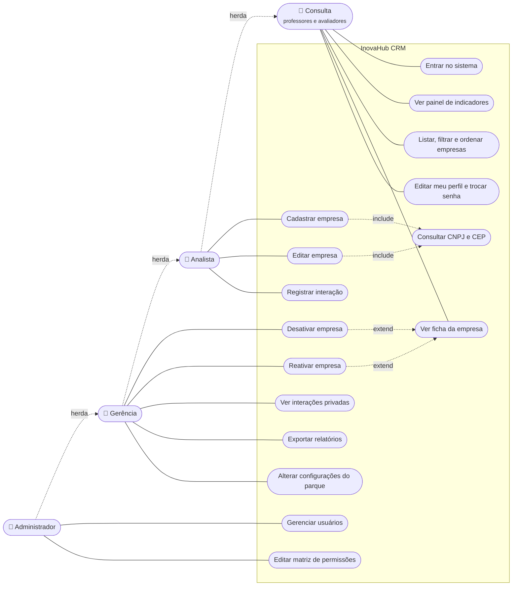

# Diagrama de casos de uso

Quatro atores usam o InovaHub, todos da equipe do parque ou da universidade. As empresas incubadas não acessam o sistema nesta versão. Cada ator herda os casos de uso do ator abaixo dele: a Gerência faz tudo que o Analista faz, e o Administrador faz tudo que a Gerência faz.

As permissões finas (ver, criar, editar, desativar, exportar) ficam na matriz de permissões, que o Administrador pode alterar. O diagrama mostra a configuração padrão.

## Descrição resumida

| Caso de uso | Ator principal | Regra principal |
| --- | --- | --- |
| Entrar no sistema | Todos | Login ou e-mail e senha. Usuário desativado ou com convite pendente não entra. |
| Listar empresas | Todos | Filtros por busca, categoria, setor, responsável e situação; ordenação por nome, contato, e-mail, categoria, última interação e data de cadastro. Sem empresas, mostra a tela vazia. |
| Cadastrar empresa | Analista | CNPJ válido e único. Se o CNPJ pertence a uma empresa desativada, o sistema sugere reativá-la. |
| Editar empresa | Analista | O CNPJ não muda depois do cadastro. Empresa desativada precisa ser reativada antes. |
| Desativar empresa | Gerência | Exige motivo e data de saída. **Não existe exclusão**: a empresa sai das listas, mas o histórico fica. |
| Reativar empresa | Gerência | Volta a empresa para a situação Ativa e encerra o registro de desativação. |
| Ver interações privadas | Gerência | Analistas e Consulta não veem interações marcadas como privadas. |
| Gerenciar usuários | Administrador | E-mail único. Usuários são desativados, nunca apagados. |
| Editar matriz de permissões | Administrador | O perfil Administrador sempre mantém acesso total. |
