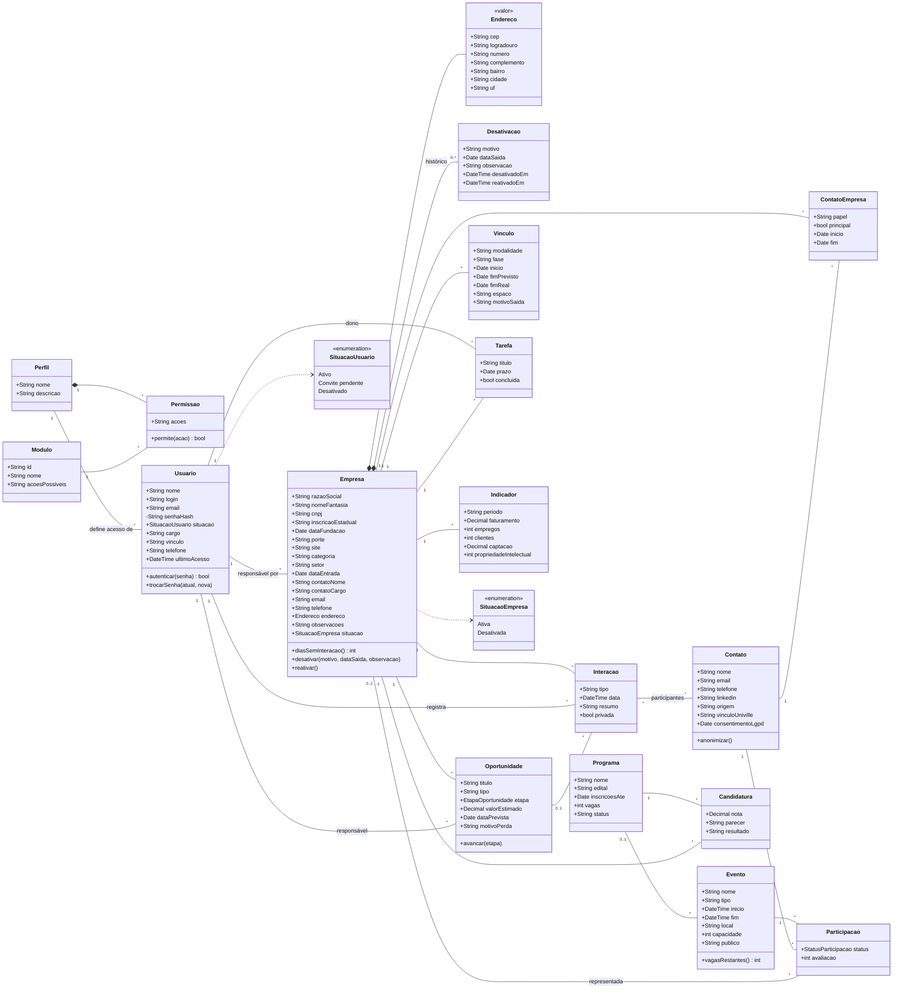
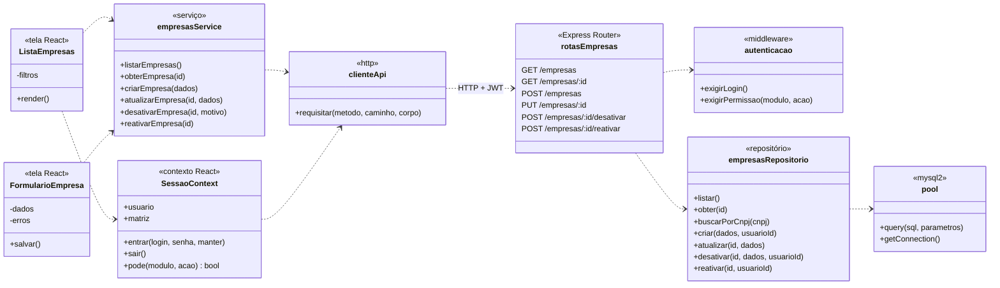

# Diagrama de classes

## Domínio

A **Empresa** é o centro do modelo: contatos, oportunidades, interações, vínculos, candidaturas e indicadores pertencem sempre a uma empresa. As classes em destaque (Empresa, Desativacao, Usuario, Perfil e Permissao) já estão implementadas nas telas e na API. As demais estão no banco e entram nos próximos módulos.

Todas as entidades têm `id`, `criadoEm` e `atualizadoEm`, omitidos no desenho para deixá-lo legível.

### Regras que o diagrama não mostra

- **Exclusão lógica.** Empresas e usuários nunca são apagados. A empresa desativada ganha um registro em `Desativacao`; ao ser reativada, o registro recebe `reativadoEm` e fica no histórico.
- **CNPJ único e imutável.** É validado (dígitos verificadores) no cadastro e não pode ser alterado na edição.
- **Categoria derivada.** Quando houver um `Vinculo` vigente, a categoria da empresa (pré-incubada, incubada, residente) vem dele.
- **LGPD.** Um pedido de remoção anonimiza o `Contato` em vez de apagá-lo, para não quebrar o histórico de interações.

## Aplicação (front-end e API)

Este diagrama mostra como o código está organizado em volta das entidades acima. As telas nunca falam com o banco: chamam um serviço, que chama a API, que usa um repositório.

