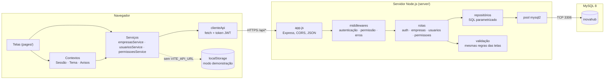

# Componentes e implantação

O InovaHub tem três partes: o front-end em React, a API em Node.js com Express e o banco MySQL. Em desenvolvimento, o Vite repassa as chamadas `/api` para a API, então o navegador enxerga tudo na mesma origem.

## Modo demonstração e modo API

| | Modo demonstração | Modo API |
| --- | --- | --- |
| Quando | `VITE_API_URL` vazio | `VITE_API_URL=/api` (ou a URL da API) |
| Dados | `localStorage` do navegador | Banco MySQL |
| Login | Senha fixa `inovahub` | Hash bcrypt + token JWT |
| Uso | Apresentar o protótipo sem instalar nada | Desenvolvimento e produção |

As telas são as mesmas nos dois modos. Só o corpo das funções em `src/services/` muda.
