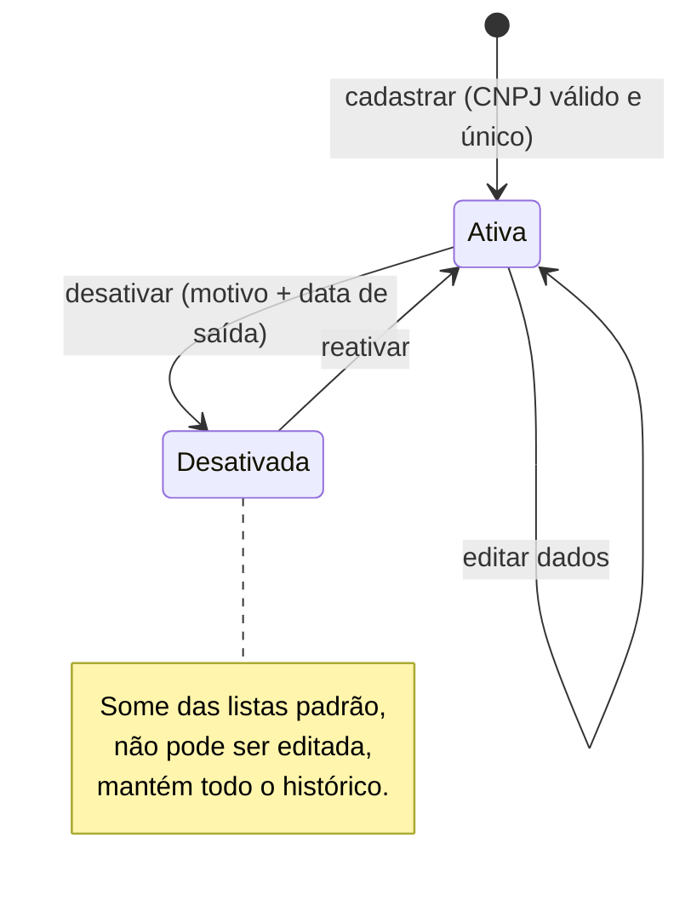
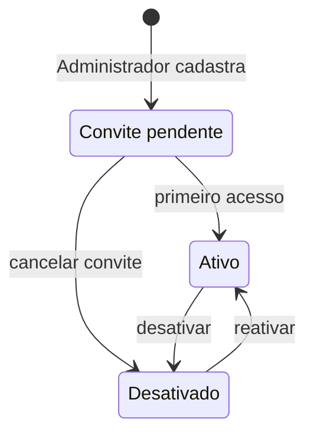
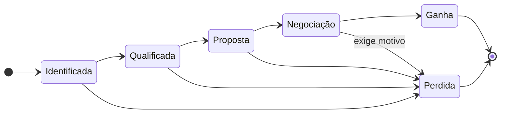

# Diagramas de estados

## Empresa

Uma empresa só tem dois estados no cadastro. Não existe estado "excluída": a desativação é a única forma de tirar uma empresa das listas.

## Usuário

## Oportunidade (próximo módulo)

Um único funil para todos os tipos de oportunidade (incubação, residência, parceria, patrocínio, investimento, edital).

