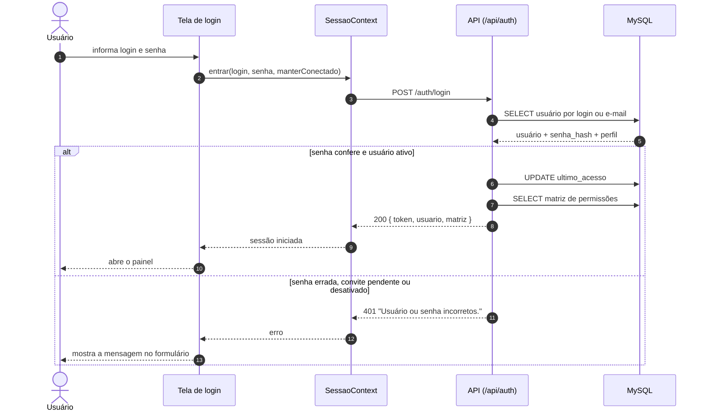
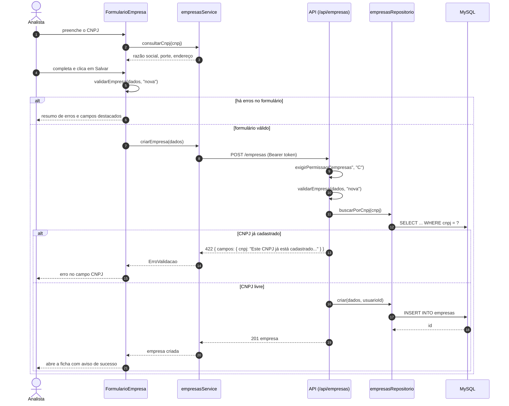
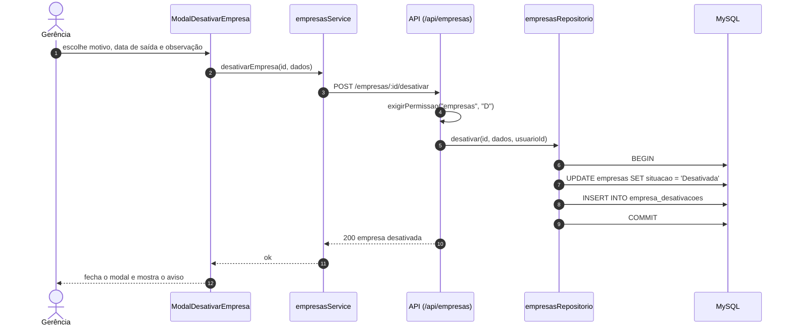

# Diagramas de sequência

## 1. Entrar no sistema

A senha nunca sai do banco: a API compara o hash com bcrypt e devolve um token JWT, que o navegador envia em todas as chamadas seguintes.

## 2. Cadastrar empresa

A validação acontece duas vezes: no navegador, para dar retorno imediato, e na API, que usa as mesmas regras e é quem confere o CNPJ duplicado no banco.

## 3. Desativar empresa

A desativação grava a situação e o histórico na mesma transação. Nenhum registro é apagado.

